<picture>
  <source media="(prefers-color-scheme: dark)" srcset="https://readme-typing-svg.demolab.com?font=Inter&weight=500&size=22&duration=3000&pause=1500&color=FF5277&vCenter=true&width=440&height=44&lines=APIs+REST+em+C%23+e+ASP.NET+Core;Aplica%C3%A7%C3%B5es+Angular+com+TypeScript;SQL+Server%2C+PostgreSQL+e+RabbitMQ;DDD%2C+testes+automatizados+e+CI%2FCD">
  
</picture>

Trabalho nas duas pontas de aplicações web: APIs em C# e ASP.NET Core e interfaces em Angular, com SQL Server e PostgreSQL na persistência. Minha experiência profissional está detalhada no [currículo](https://augustosantos.com.br/PDF/Curriculo-Augusto-Farias-dos-Santos.pdf).

Curitiba, PR · remoto ou híbrido · **disponível para novas oportunidades**

<h3></h3>

  
  

<picture>
  <source media="(prefers-color-scheme: dark)" srcset="https://raw.githubusercontent.com/AugustoAFS/AugustoAFS/output/github-contribution-grid-snake-dark.svg">
  
</picture>

  

